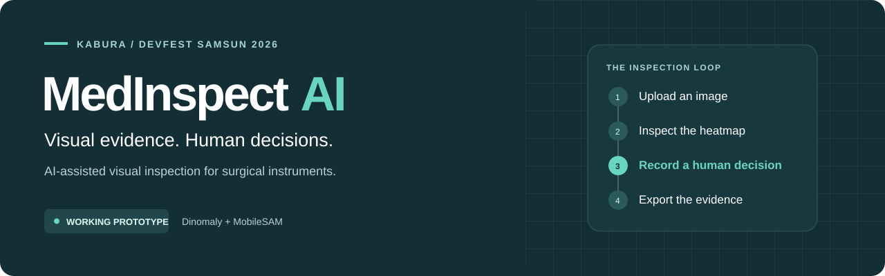
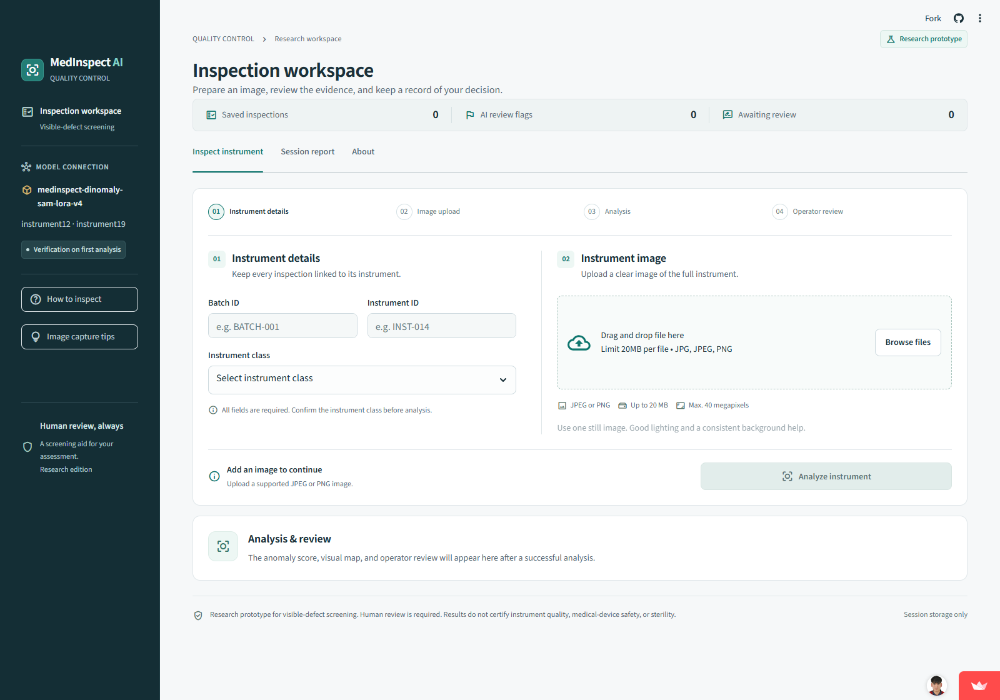
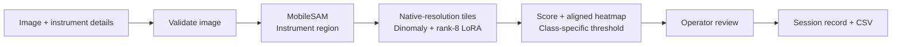
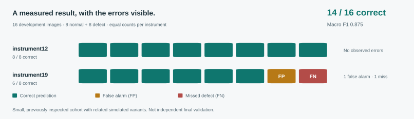

<p align="center">
  
</p>

<p align="center">
  <a href="https://medinspect-ai-devfest.streamlit.app/"><strong>Open the live application ↗</strong></a>
  &nbsp; · &nbsp;
  <a href="#quick-start">Run locally</a>
  &nbsp; · &nbsp;
  <a href="#development-results">Measured results</a>
  &nbsp; · &nbsp;
  <a href="#documentation">Documentation</a>
</p>

<p align="center">
  <a href="https://github.com/Habibsultani/Devfest_hackathon/actions/workflows/checks.yml?query=branch%3Afeature%2Fstreamlit-deployment"></a>
  
  
  
</p>

<h1 align="center">MedInspect AI</h1>

<p align="center">
  <strong>Find suspicious regions. Review the evidence. Keep a traceable decision.</strong><br>
  Cerrahi aletlerde yapay zekâ destekli görsel kalite kontrol.<br>
  Built by <strong>Kabura</strong> for <strong>DevFest Samsun 2026</strong>.
</p>

---

## The project

Small surface defects, reflective metal and complex images make surgical-instrument
inspection challenging. MedInspect AI brings image analysis, visual evidence and
operator review into one browser-based workflow.

Upload a photograph, inspect a real **Dinomaly + MobileSAM** prediction, record
your own decision and download the inspection record. The application runs genuine
model inference; it never substitutes a fabricated result when a model is unavailable.

> **Research prototype.** MedInspect AI supports visible-anomaly screening. It does
> not certify product quality, medical-device safety or sterility. The final
> assessment belongs to the operator.

| Supported instruments | Accepted images | Review outcomes | Reporting |
| :--- | :--- | :--- | :--- |
| `instrument12` · `instrument19` | JPEG / PNG · up to 20 MB · up to 40 MP | Accept · Flag for review · Inconclusive | Session records → CSV |

## From photograph to recorded decision

| Step | What happens |
| :--- | :--- |
| **01 · Identify** | Enter the batch ID and instrument ID; manually select the supported instrument class. |
| **02 · Upload** | Add a photograph. The app validates the file and preserves its oriented, native-size image. |
| **03 · Analyze** | Review the anomaly score, class-specific threshold and aligned heatmap beside the original. |
| **04 · Decide** | Record an independent operator decision and, when needed, an explanatory note. |
| **05 · Export** | Download all saved session records with their timestamps and model provenance. |

### The inspection workspace

<a href="https://medinspect-ai-devfest.streamlit.app/">
  
</a>

*Captured from the public application in a fresh session; no dataset photographs
or inspection exports are embedded in this preview.*

## Built around the operator

<table>
  <tr>
    <td width="50%" valign="top">
      <h3>Visual evidence</h3>
      <p>Original image and heatmap side by side, an adjustable overlay and a fixed model-specific color scale. The anomaly score is not a defect probability.</p>
    </td>
    <td width="50%" valign="top">
      <h3>Independent human review</h3>
      <p>Accept, flag for review or mark a result inconclusive. Operator decisions remain separate from the model flag; inconclusive decisions require a note.</p>
    </td>
  </tr>
  <tr>
    <td valign="top">
      <h3>Traceable records</h3>
      <p>Batch and instrument IDs, UTC timestamps, scores, thresholds, model versions and integrity hashes travel with the recorded decision.</p>
    </td>
    <td valign="top">
      <h3>Checked inputs and outputs</h3>
      <p>File limits, genuine image decoding, SHA-256 model verification, aligned finite maps and CSV formula escaping are part of the inspection workflow.</p>
    </td>
  </tr>
</table>

Changing the image, IDs or class clears the previous result. Records can be
searched and filtered; CSV export always includes the full saved session.
**History is session-only:** download the CSV before leaving or restarting.

## How it works



Both instrument classes share the trained checkpoint and use separate
validation-derived thresholds. Native 256-pixel tiles are resized to 252 for the
encoder's stride. Maps are stitched back into the original image coordinates.
The application caches model resources and serializes inference.

| Layer | Technology | Responsibility |
| :--- | :--- | :--- |
| Application | Streamlit · Python 3.12 | Uploads, inspection workspace, human decisions and CSV |
| Image handling | Pillow · OpenCV · NumPy | Decoding, orientation and image/map operations |
| Segmentation | MobileSAM | Instrument-region masks |
| Anomaly detection | PyTorch · Anomalib Dinomaly · DINOv2 · LoRA | Patch analysis, anomaly scores and maps |
| Verification | pytest · Ruff · Playwright · GitHub Actions | Automated checks, browser acceptance and container startup |
| Deployment | Streamlit Community Cloud · Docker recipe | Public demo and reproducible deployment setup |

The operator selects the instrument class. The model does **not** automatically
identify instrument types or classify named defect categories.
See the [architecture](docs/architecture.md) and [inference contract](docs/inference_contract.md).

## Development results



| Instrument | Correct / total | True positives | False positives | True negatives | False negatives | Image AUROC |
| :--- | ---: | ---: | ---: | ---: | ---: | ---: |
| `instrument12` | **8 / 8** | 4 | 0 | 4 | 0 | 1.0000 |
| `instrument19` | **6 / 8** | 3 | 1 | 3 | 1 | 0.8125 |
| **Combined** | **14 / 16** | **7** | **1** | **7** | **1** | — |

**Macro F1: 0.875.** The comparison contains eight normal and eight defect images.
The missed defect includes a known `instrument19` corrosion example.

These are **development results, not independent final validation**. The cohort
is small, includes related simulated variants and was inspected during earlier
experiments. Performance on new production images remains to be established.
Pixel AUROC was 0.9941 for `instrument12` and 0.9785 for `instrument19`.

| Evidence | Where to inspect it |
| :--- | :--- |
| Active model metrics | [Dinomaly results](reports/dinomaly_metrics.json) |
| Selection and calibration rules | [Frozen model protocol](reports/dinomaly_protocol.json) |
| Predictions, audits and plots | [instrument12](reports/dinomaly/instrument12/) · [instrument19](reports/dinomaly/instrument19/) |
| Real application integration | [Browser / model / CSV acceptance](reports/integration_smoke.json) |
| Limitations and interpretation | [Evaluation notes](docs/evaluation.md) |

<details>
<summary><strong>Why Dinomaly? Earlier baselines are documented too.</strong></summary>

The balanced whole-image PatchCore baseline missed all four defects for each
instrument at its validation-selected threshold. A region variant improved some
detections but also produced false alarms. Neither became the deployed model.

The active replacement uses Dinomaly, MobileSAM, native-resolution tiles and
rank-8 LoRA. The [balanced baseline](reports/balanced_metrics.json),
[region experiment](reports/region_experiment.json) and
[historical pilot summary](reports/baseline_summary.json) remain available.
Full historical outputs are accessible through the revision recorded in the summary.

</details>

## Quick start

### Try the hosted application

Open **[medinspect-ai-devfest.streamlit.app](https://medinspect-ai-devfest.streamlit.app/)**.
No local installation or GitHub token is needed to use the public interface.
Enter the required IDs, select the correct supported class and upload an image.
Review the result before recording a decision.

### Run locally

**Prerequisites:** Python **3.12**, Git and access to the trained model artifacts.
CPU inference is supported; NVIDIA CUDA is recommended for training.

```bash
git clone --branch feature/streamlit-deployment https://github.com/Habibsultani/Devfest_hackathon.git
cd Devfest_hackathon
python -m venv .venv
```

Activate the environment using the command for your shell:

| Shell | Command |
| :--- | :--- |
| Windows PowerShell | `.\.venv\Scripts\Activate.ps1` |
| macOS / Linux | `source .venv/bin/activate` |

```bash
python -m pip install --index-url https://download.pytorch.org/whl/cpu torch==2.8.0 torchvision==0.23.0
python -m pip install -r requirements-lock.txt --extra-index-url https://download.pytorch.org/whl/cpu
python -m scripts.setup_research_models
python -m scripts.fetch_model --all --github-auth
python -m scripts.doctor --require-model
python -m streamlit run app.py
```

Open `http://localhost:8501`.

> **Model access:** source code is public, but trained weights are currently in a
> team draft release. The download step needs authorized `GITHUB_TOKEN` access or
> existing Git credentials; anonymous cloning alone does not provide the weights.
> Alternatively, supply the verified local artifacts or reproduce the model.
> Both checkpoints are SHA-256 checked. Keep credentials outside source files.
> See [model retrieval and deployment](docs/deployment.md#model-retrieval).

<details>
<summary><strong>Launchers, command-line inference and Python API</strong></summary>

| Platform | Launcher |
| :--- | :--- |
| Windows | `powershell -NoProfile -ExecutionPolicy Bypass -File scripts/start.ps1` |
| macOS / Linux | `bash scripts/start.sh` |

Use `-Setup` / `--setup` to install dependencies, `-CheckOnly` / `--check` for
diagnostics, or `-Port 8503` / `--port 8503` to change the port.

```bash
python -m scripts.inspect_image path/to/image.png --instrument instrument19
```

```python
from PIL import Image
from src.inference import inspect_image

result = inspect_image(Image.open("image.png"), instrument_class="instrument12")
score = result["anomaly_score"]
heatmap = result["anomaly_map"]  # Original-size NumPy float32 array.
requires_review = result["requires_review"]
```

</details>

## Reproducibility and checks

| Check | Coverage |
| :--- | :--- |
| Unit and integration tests | Split balance, source-group leakage, map alignment, calibration, artifact integrity and error paths |
| Real-model browser acceptance | Direct inference / gateway parity, five-image upload and review, class switching and CSV values |
| Hosted acceptance | Five original-image workflows, operator decisions, CSV parity and an empty separate browser session |
| CI | Dependency consistency, lint, formatting, tests, cloud entrypoint, browser workflow and container startup |

Hosted acceptance checks application integration; it is not a new accuracy study.
Hosted server-reboot acceptance has not been recorded.

```bash
python -m scripts.doctor --require-model
python -m pip check
python -m pytest -q
python -m ruff check .
python -m ruff format --check .
```

Some integration tests require the prepared dataset and verified weights and skip
on a source-only checkout. See [evaluation notes](docs/evaluation.md).

<details>
<summary><strong>Reproduce training and run the real browser check</strong></summary>

Use a separate CUDA environment with `requirements-gpu.txt` or the complete
`requirements-gpu-lock.txt` for training.

```bash
python -m scripts.download_dataset --instruments instrument12 instrument19
python -m scripts.run_research_pipeline
```

| Split per instrument | Normal | Defect |
| :--- | ---: | ---: |
| Training | 12 | 0 |
| Validation | 4 | 4 |
| Development comparison | 4 | 4 |

Source-group manifests and the protocol are frozen before fitting. Related source
groups stay in one fold; optimization balances both instrument types. Thresholds
and checkpoint selection use validation only. The recorded run trained for 1,000
steps on an RTX 3060 6 GB; validation selected step 200.

After installing Playwright and preparing the original dataset classes:

```bash
python -m scripts.check_real_app
```

Set `MEDINSPECT_NODE_MODULES` to the directory containing Playwright and optionally
`MEDINSPECT_RUNTIME_NODE` to Node. Chrome is the default browser; set
`MEDINSPECT_BROWSER_CHANNEL=chromium` to use installed Playwright Chromium.
Screenshots and CSV stay in ignored `artifacts/integration/`; numerical evidence
is written to `reports/integration_smoke.json`. The known corrosion miss is retained.

</details>

## Deployment and source delivery

| Setting | Value |
| :--- | :--- |
| Live host | Streamlit Community Cloud |
| Deployment branch | `feature/streamlit-deployment` |
| Cloud entrypoint | `cloud/streamlit/app.py` → root `app.py` |
| Runtime | Python 3.12 · tested CPU dependency lock |
| Alternative deployment | Docker recipe with non-root execution and HTTP health check |

The hosting environment supplies model-download credentials. Image data, model
weights, secrets, inspection exports and virtual environments are excluded from Git.
See [deployment instructions](docs/deployment.md) for setup and troubleshooting.

Create a source archive within the hackathon's **10 MB** upload limit:

```bash
python -m scripts.package_source --max-size-mb 10
```

The ZIP in `dist/` includes a revision/file-hash manifest and a SHA-256 companion
file. Weights and datasets are downloaded separately. Presentation and demo video
are separate submission files.

## Documentation

| Guide | What it explains |
| :--- | :--- |
| [Architecture](docs/architecture.md) | Components, model gateway and session lifecycle |
| [Inference contract](docs/inference_contract.md) | Inputs, output fields and validation rules |
| [Deployment](docs/deployment.md) | Local / cloud / Docker setup and model access |
| [Dataset](docs/dataset.md) | Provenance, splits, masks and restrictions |
| [Evaluation](docs/evaluation.md) | Calibration, measurements and limitations |
| [Research sources](docs/research_sources.md) | Reused implementations, adaptations and attribution |

## Scope and next steps

| Available now | Future work |
| :--- | :--- |
| Two manually selected instrument classes | Additional classes and broader production data |
| Research-cohort anomaly detection | Independent evaluation across cameras, lighting and factories |
| Session review and CSV export | Persistent storage, access control and production-system integration |
| Verified CPU inference and public demo | Measured capacity planning and a dedicated GPU-backed service |

False alarms and missed defects are possible. The current data includes simulated
defects and related image variants. Shared-host cold starts and inference time
must be assessed separately from warm-cache CUDA measurements.

## Team Kabura

| Team member | Role | Contribution |
| :--- | :--- | :--- |
| **Ehsan Amini** | **Team Lead · AI & Model Development** | Dataset preparation, research pipeline, model adaptation, training and evaluation |
| **Habib Sultani** | **Application & Deployment** | Interface, model integration, operator review, CSV reporting, application acceptance and cloud deployment |

## Research credit and data use

The project adapts published methods and official implementation components;
it does not claim a newly invented foundational model or an exact reproduction
of the dataset paper.

| Source | Reference |
| :--- | :--- |
| Dataset | [Purdue VIPER surgical-instrument dataset](https://huggingface.co/datasets/purdueviperlab/Surgical_Instruments_Unsupervised_Defect_Detection) |
| Dataset paper | [Surgical-instrument defect-detection research](https://arxiv.org/html/2509.21561v2) |
| Dinomaly | [Official implementation](https://github.com/guojiajeremy/Dinomaly) · [Anomalib 2.2.0 integration](https://github.com/open-edge-platform/anomalib/tree/v2.2.0/src/anomalib/models/image/dinomaly) |
| MobileSAM | [Official implementation](https://github.com/ChaoningZhang/MobileSAM) |

Dataset revision: `e791b82e9616889e356b4cf7d40d6b56ba87b0c5`.
The dataset author declares **CC-BY-NC-ND-4.0**; these are not unrestricted
commercial-use data. Upstream code notices are retained under
[`docs/licenses/`](docs/licenses/). These notices apply to their respective
components, not automatically to all original project code. See
[research attribution](docs/research_sources.md) for the implementation deviations.

---

<p align="center">
  <strong>Kabura · MedInspect AI · DevFest Samsun 2026</strong><br>
  <a href="https://medinspect-ai-devfest.streamlit.app/">Explore the working prototype ↗</a>
</p>
