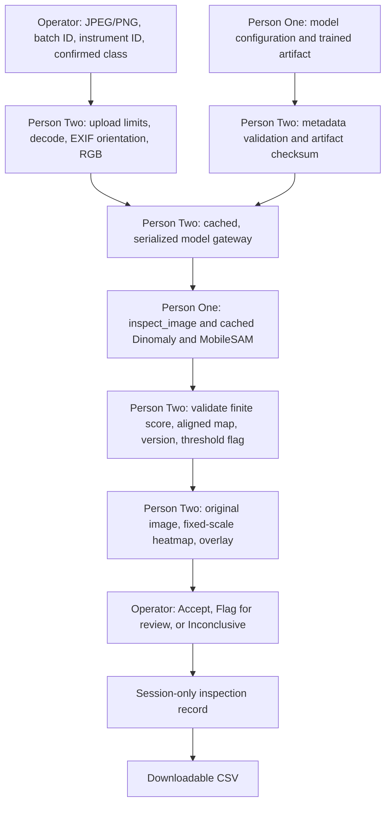

# Application architecture

The application accepts an instrument image, obtains a real model result through Person One's API, displays suspicious regions, and records an independent operator decision. The model and application branches are integrated. Both instrument classes share the trained Dinomaly checkpoint and use separate validation thresholds.

The interface uses shared components in `src/ui.py` and typography, color, spacing and responsive rules in `assets/styles.css`. Fonts and icons reuse the pinned Streamlit package's local assets, without an external font service. The session overview reflects saved records and any current analysis awaiting a human decision.

## Component boundaries

| Component | Owner | Input | Output |
| --- | --- | --- | --- |
| Upload and metadata | Person Two | File bytes and operator metadata | Original-size, oriented PIL RGB image |
| Configuration and artifact verification | Person Two | Trusted JSON and model file/URL | Verified metadata and SHA-256 artifact |
| Preprocessing and Dinomaly inference | Person One | PIL RGB image | Score, aligned H × W map, flag, version |
| Result validation | Person Two | Inference dictionary and model metadata | Immutable result snapshot or clear error |
| Visualization | Person Two | RGB image, map, fixed display scale | Heatmap and blended overlay |
| Human review and reporting | Person Two | Result snapshot and explicit operator decision | Session record and CSV |

`src/uploads.py` decodes the image and applies EXIF orientation before inference. It does not resize, normalize, or create tensors. Person One applies the exact saved model transforms once. The inference module must resize its anomaly map back to the supplied oriented image coordinates.

## Model lifecycle

Every app rerun reads and validates metadata. Analysis obtains a Streamlit resource-cached gateway keyed by the configuration and artifact file revision. On first use, the gateway verifies the artifact SHA-256, downloading it atomically from a configured HTTPS URL only if missing, and imports Person One's `inspect_image` function. Person One must cache the actual loaded Dinomaly and segmentation models inside their module. No model objects or Anomalib internals cross the interface.

Shared gateways serialize inference with a lock so an underlying model cannot concurrently mutate shared buffers. The returned map is copied while holding the lock, checked for shape and finite values, and stored read-only. The raw score and flag must agree with the release threshold, including equality (`score >= threshold`). Version mismatches fail explicitly.

Only deployment-controlled configuration may name artifact paths and URLs. Uploaded files never supply configuration or executable model files. Person One's deserializer should load only the verified, trusted artifact.

## Visualization semantics

The model configuration supplies fixed minimum and maximum map values suitable for that model. A five-anchor approximation of Viridis maps low values from purple through teal to yellow for higher values. The same value has the same color across images. Out-of-range map values clip for display only. The image-level score, threshold comparison, and operator decision never depend on overlay opacity or display colors. Bilinear interpolation supports standalone map resizing, but production inference must already return an aligned map.

## Session lifecycle and data integrity

Session state stores inspection records and at most one active analysis. The active analysis snapshots the upload digest, IDs, filename, result, model metadata, analysis timestamp, and inference latency. Any change to the image, IDs, class, or model configuration clears it. A failed retry also clears it. The review form requires an explicit decision and permits one saved record per analysis UUID.

Records include both analysis and save timestamps in UTC, model/config/artifact identifiers, raw score, threshold, AI flag, and the separate human decision. CSV exports quote commas and newlines and escape leading spreadsheet formulas in string fields. The browser session is the only history boundary. Server restart, session expiration, or a new browser session may lose unexported records. There is no persistent storage or cross-user history.

## Dependencies and deployment flow

The combined app runs on Python 3.12. `requirements.txt` pins direct model and UI dependencies; `requirements-lock.txt` captures the CPU environment. GitHub Actions checks the combined stack, browser workflow and container startup. The push workflow also retrieves verified weights and tests real-model browser/CSV parity.

Reviewed application and inference branches merge into `main`. Streamlit Community Cloud runs `cloud/streamlit/app.py`, which delegates to the root application and selects the tested CPU lock. It retrieves/verifies both model artifacts and serves the UI. Public browser checks exercised real inference, human decisions, CSV parity and an empty separate session. See [deployment](deployment.md) and the [inference contract](inference_contract.md).
